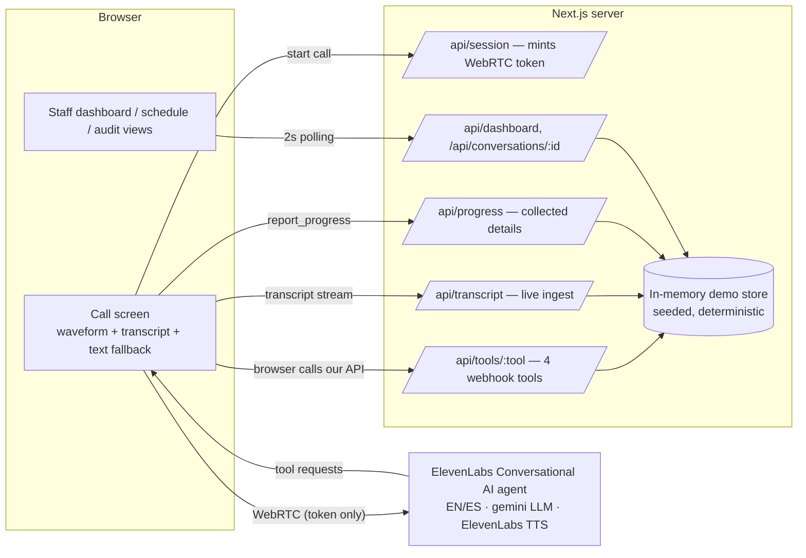

# ShopTalk AI — Architecture (judge-facing)

## One paragraph

ShopTalk AI is a Next.js (TypeScript) web app whose front end hosts two experiences: a
browser-based voice call powered by the ElevenLabs Conversational AI agent (WebRTC), and a staff
dashboard that polls the app's own API. The agent's intelligence — bilingual understanding,
turn-taking, tool calls — runs on ElevenLabs; our server owns the business logic, the demo data
store, and the safety gates. Nothing sensitive ever reaches the browser: the ElevenLabs API key
stays server-side, and the call screen receives only a short-lived WebRTC session token minted by
our backend.

## Components

## The five agent tools (client-side, executing against our server API)

All five tools are **client tools** registered in the browser. When the agent decides to call
one, the ElevenLabs SDK hands it to the browser, which fetches `/api/tools/<name>` on our own
Next.js server. The server processes it and returns the result, which the SDK relays back to the
agent. This architecture means no webhooks, no tunnels, and no public URLs are needed.

| Tool | What it does | Safety property |
|------|--------------|-----------------|
| `check_availability` | Returns real open slots from the seeded calendar | agent can only offer times that exist |
| `create_appointment` | Books an appointment | **rejects the call unless `confirmed=true`** — the confirmation gate is enforced in server code, not just the prompt; also rejects missing fields, bad date formats and double-booked slots |
| `get_estimate` | Returns a fixed demo price range | the agent can never invent a number; unknown categories fall back to "diagnostics", and every response carries a demo-data disclaimer |
| `request_human_callback` | Flags the conversation for human follow-up | escalation path for price, anger, safety and uncertainty |
| `report_progress` | Internal UI helper: updates collected-details tiles and persists them to the conversation record | keeps the dashboard's structured view in sync |

Every tool invocation is written to an **audit trail** (timestamp, tool, arguments, result,
success/blocked) that the dashboard renders per conversation.

## Language handling

The agent's LLM (Gemini, hosted by ElevenLabs) is instructed to mirror the customer's language on
every turn and switch instantly mid-conversation; ASR (ElevenLabs Scribe realtime) transcribes
either language. The detected language is stored per conversation and shown in the UI, and is
passed to `create_appointment` so the shop knows which language to call back in.

## Text fallback

If microphone access is denied or unavailable, the user can start a **text-only session** using
the ElevenLabs SDK's `TextConversation.startSession()` with `textOnly: true`. This creates a
WebRTC session without audio — the agent receives typed text and responds with text. All five
tools work identically in text mode, the transcript and audit trail are saved the same way, and
the confirmation gate is enforced by the server exactly as in voice mode.

## Why this shape

- **ElevenLabs owns voice** (STT, LLM orchestration, TTS, WebRTC transport) — lowest latency,
  real voices, no bespoke audio pipeline for a hackathon.
- **Our server owns data and rules** — safety gates live in code where they can be tested
  (`tests/appointment.test.ts`: 8 passing tests covering confirmation gating, validation,
  slot conflicts, estimate boundaries).
- **In-memory deterministic store** — seeded fictional data, zero infra, identical demo every
  run; every record and price is labeled "demo data".
- **Polling dashboard** — simple and reliable on venue Wi-Fi; no websockets to debug at the
  demo table.

## Mel usage

The project was built with the Mel agent end-to-end: ElevenLabs onboarding and agent creation
(via the ElevenLabs CLI driven from Mel), all code authored and debugged by the agent, and the
end-to-end scenarios (Spanish booking, English estimate + escalation) verified by Mel against
the running server.
